# StudyAgent 答疑链路与协作安全审查

审查日期：2026-10-23；代码基线：`6aee7f6`。本文依据本地实际代码；不将 AGENTS.md 中的设计描述直接当作已实现行为。只新增本文及配套审计摘要，没有修复业务代码、提交、推送或操作生产环境。

> 后续范围确认：用户已明确外部模型与 PDF 解析外发是预期设计，本轮修复不改变外部服务调用、故障切换或公网解析暂存路径。以下为修复前审查快照，修复进展另见 `协作安全修复记录-2026-10-23.md`。

## 1. 结论

九科共用一条答疑主干；学科差异主要在教学策略、检索排序、提示词和四科专属动作。物理使用独立策略服务，另外八科使用声明式规则表。不是九套独立模型或九个独立 API。

协作前应优先处理：已跟踪文档中的 SSH 凭据文字、本地敏感文件误提交风险、教师跨班画像越权，以及开发者接触生产数据库后同时接触学生数据和模型密钥的问题。没有证据证明仓库已被外部人员获取，也未验证文档中的凭据当前有效。

## 2. 九科共用答疑主干

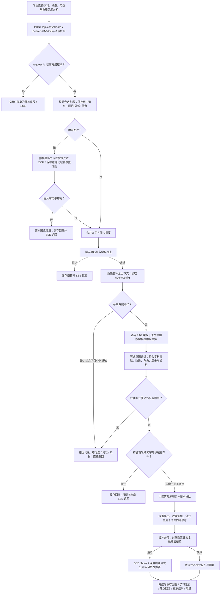

关键事实：

- 图片理解发生在普通输入话题过滤之前，也在主回答额度预留和排队之前。图片可能先发送外部模型，之后才拒答。
- 首轮纯文字专属动作会提前返回；图片轮或其他未提前返回的情况还会在 RAG、Prompt 构建后再检查同类动作。不要把这些直接回复画成必经大模型生成。
- 阶段依据历史轮数：0 轮 initial、1–2 轮 hint、≥3 轮 fallback。`socratic_service.py:43` 当前写死阈值；并未按 AGENTS.md 所说读取 `fallback_after_turns`。
- Prompt 包含最近 6 条历史消息、年级、检索资料、学科补充提示词、角色及图片理解信息。深度分析增加公开学习摘要要求，不公开模型内部推理。
- 模型来自用户选择、数据库配置及服务路由；不能据 AGENTS.md 就断定线上一定使用其中列出的固定主备模型。本轮未查询生产配置。
- RAG：学科集合向量召回 → 数据库加载片段 → 年级与题型重排 → 排除禁用题；失败或无有效结果时走数据库检索。会话缓存与全局热点回答缓存是两套机制。
- 模型主回答生成前有额度与排队控制；视觉理解、可选意图分类等辅助调用不能据此视为已受同一控制覆盖。
- 输出是逐段校验后推送；后续发现问题时，已经发出的前文无法撤回，不等于全文生成完成后统一审核。

证据入口：`backend/routers/chat.py:1616`、`:1926`、`:2097`、`:2443`、`:2537`、`:2709`；`backend/services/chat_image_understanding_service.py:72`；`backend/services/socratic_service.py:117`。

## 3. 各学科差异图

以下每幅图均接在共用主干的“学科策略/专属动作”位置；“进入共用生成”继续经过 RAG、Prompt、缓存、额度、模型与输出校验。图中文字是教学引导要求，不代表后端真的生成了受力图、光路图或专门的学科求解器。

### 物理

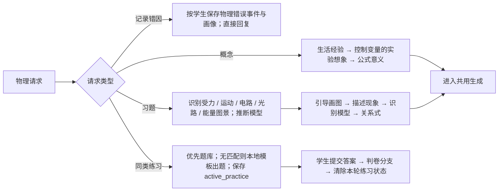

独立服务：`physics_guidance_service.py`、`physics_error_profile_service.py`。图景与模型识别目前主要是关键词规则，不是经过验证的物理解题推理器。RAG 内置题库加分 0.12。

### 数学

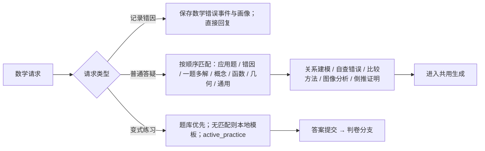

规则先命中先胜；不是并行组合所有策略。RAG 内置题库加分 0.12。

### 英语

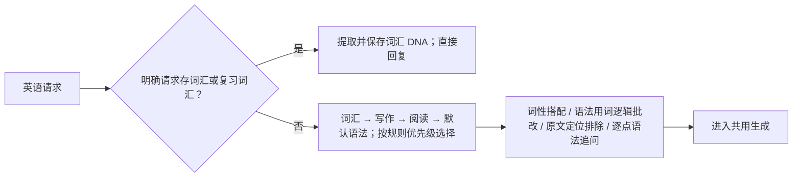

### 语文

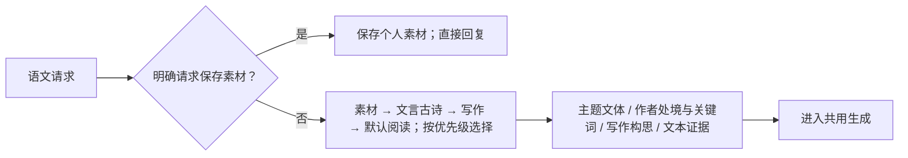

RAG 内置材料加分 0.10、top_k=5。

### 化学

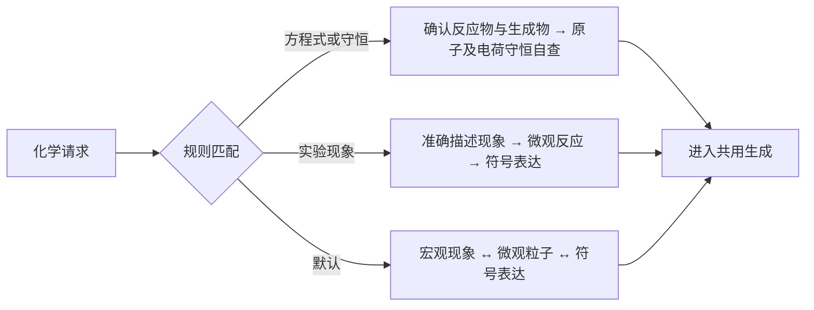

### 生物

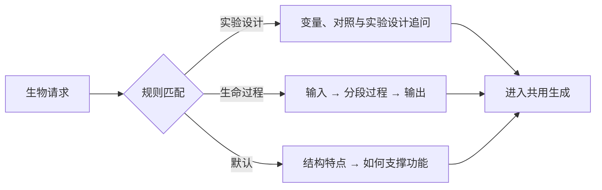

### 历史

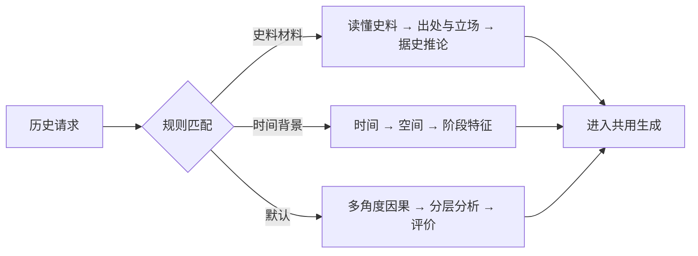

RAG 内置材料加分 0.10、top_k=5。

### 地理

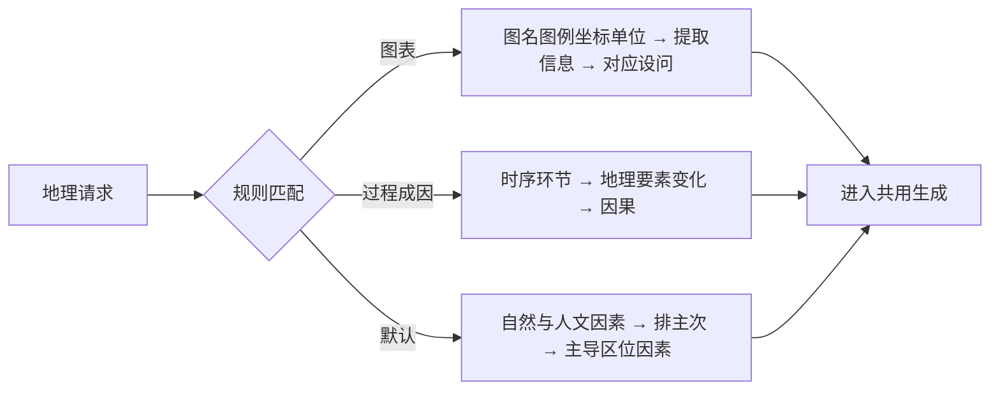

### 政治

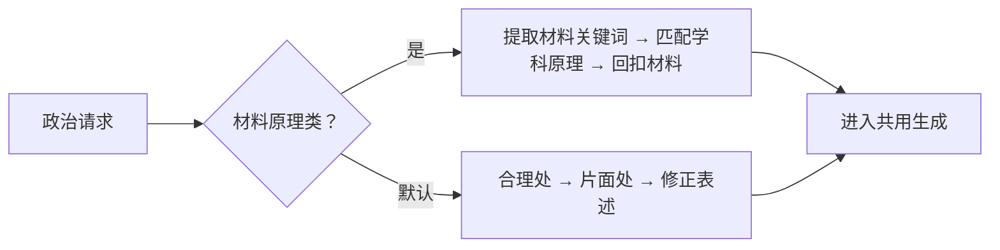

RAG 内置材料加分 0.10、top_k=5。

八科规则：`backend/services/subject_guidance_service.py:63`；RAG 差异：`backend/services/rag_service.py:98`。英语、化学、生物、地理默认走公共 RAG 参数。实际配置可通过 `RAG_SUBJECT_POLICIES` 覆盖。除物理外，规则低置信时可启用 LLM 意图分类；默认关闭，仅对非图片、非判卷轮且符合配置学科白名单的请求生效。

## 4. 数据边界图

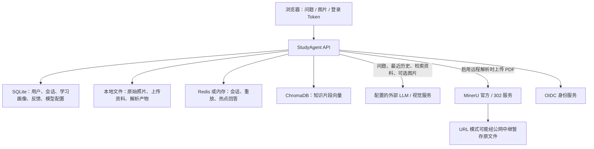

内网部署描述的是访问入口。外部 API、第三方故障切换与公网文件中继是另外的数据边界。当前实现未在发送前提供统一的姓名、学号、班级、照片区域脱敏步骤；未发现完整的学生可见数据用途、外部接收方及保留期限说明。第三方是否留存、训练或跨境处理需由实际合同和服务配置核实；本报告不作法律合规结论。

## 5. 安全与隐私问题清单

优先级含义：P0＝邀请协作者前先处理；P1＝高优先级补齐权限或数据边界；P2＝随后加固。风险优先级不表示已经发生泄露。

| 优先级 | 发现与证据 | 影响与建议 |
|---|---|---|
| P0 | 已跟踪 `AGENTS.md:62` 写有具体 SSH 凭据文字 | Clone 即可看到；未核实当前有效性。移除明文；若仍有效或与其他系统复用则轮换。再评估 Git 历史清理；仅删当前行不会清除历史。本报告不复述凭据。 |
| P0 | `.env.bak-sso` 未被忽略，含非空 JWT secret 与管理员密码字段；`artifacts/` 也未被忽略 | `git add .` 可误纳入。`.env` 和备份当前权限均为 0644。忽略 `.env.*` 并保留 example，隔离诊断目录；敏感文件设为仅本人可读。更不能直接发整个工作目录或生产目录压缩包。 |
| P1 | 跨班学生画像越权：`backend/routers/stats.py:23` 只限制学生读别人，教师不限目标；`stats_service.py:102` 不接收 viewer | 本地合成 A 班教师读取 B 班学生画像，HTTP 200。可暴露使用情况及物理错因画像。统一验证教师任教班级，补跨班 403/404 回归。其他统计列表已有班级 scope，单人接口漏用。 |
| P1 | 模型账户密钥明文存数据库：`backend/models/llm_account.py:30`、`llm_provider.py:18`；路由直接赋值 | 分享“测试库备份”可能同时分享模型调用凭据。管理 API 用 has_api_key 隐藏响应有益，但不能保护数据库副本。开发库重建合成数据；密钥用独立密钥管理或受控加密。系统参数服务已对部分 MinerU secret 用 Fernet，覆盖范围不同。 |
| P1 | 问题、历史、RAG 内容、图片可发外部服务；图片理解先于话题检查、主额度与队列：`chat.py:1775` 起、`:1859`、`:2537` | 拒答不代表图片未外发；辅助调用也可能消耗外部额度。设统一外发策略、图片裁剪脱敏、辅助调用限流和可追踪用量；开发默认模拟模型、禁止接触生产数据。 |
| P1 | 远程 PDF 解析的 legacy public_files 分支：`mineru_remote_service.py:588` 将原文件复制到 public_files，返回可预测任务号加原文件名的 URL，cleanup=None | 配置公网 base 并启用该路由时会产生可访问原文件且此分支无清理回调。中继路径有随机 URL 和清理回调，TTL 仅见客户端注释，本轮未核服务器落实。默认禁止敏感原件公网暂存；改短期授权 URL、生命周期和删除核验。 |
| P1 | 无生产启动弱密钥拒绝：`config.py:21` 默认 JWT secret 为公开常量；启动无环境校验 | 本地 `.env` 的 JWT secret 与默认不同；不据此断言生产使用弱密钥。新协作者部署若漏配置可签发伪造 Token。生产启动必须拒绝默认/缺失密钥。默认管理员密码仍存在，但当前学生/教职工密码登录路由已返回 403，不能把它误报成已证实可登录漏洞。 |
| P1 | Compose 发布后端、Prometheus、Grafana 到全部宿主接口，Grafana 配置公开默认管理口令：`docker-compose.yml:40`、`:117`、`:126`、`:131` | 可绕过入口代理控制；Grafana 首次初始化有弱口令风险，已有数据卷的实际密码未核实。绑定可信接口/回环或防火墙限制，关闭不必要端口，显式配置管理密钥。未声称这些端口已暴露公网。 |
| P1 | npm registry 对锁文件生产依赖审计：11 项包级风险，其中 high 9、moderate 1、low 1 | 包括 axios、vue 依赖链、lodash 等。报告中的包级计数不是 11 个已证实可利用的应用漏洞；部分仅 Node HTTP adapter、SSR 或构建场景触发。逐条核实可达性并升级锁文件，测试答疑、公式、登录及构建；不运行无差别 audit fix --force。 |
| P2 | 学生清空会话仅设置 deleted_by_student_at：`chat.py:1558`；附件读取只查 owner：`:1472` | 清空不删除消息、原图、画像、缓存和备份；持有原附件 ID 的本人仍可能读取附件。明确“清空列表”与“删除数据”的语义，制定保留期限与跨存储清理流程。 |
| P2 | access、refresh、id_token_hint 存 localStorage：`frontend/src/utils/authSession.ts:48`、`backend/routers/auth.py:113`；默认 SSO 与 Nginx 使用 HTTP | 同源脚本能读取持久 Token，HTTP 传输缺保护。当前文本渲染有转义和 URL 协议限制，未发现可直接复现的聊天 XSS，不能直接宣称 Token 已可被窃取。按环境推进 HTTPS、Cookie 会话与 CSP，并验证 SSE/SSO 兼容。 |
| P2 | `/health`、`/metrics` 未鉴权：`backend/main.py:125`；Nginx 显式代理 metrics | 可披露运行组件、路径、错误、流量和模型统计；未发现返回 API key。health 对外最小化，详细诊断和监控限制到管理网络。 |

### 教学与成本控制的额外问题

1. **练习判卷允许正确答案，与仓库硬约束冲突。** `socratic_service.py:215` 明示判卷可给正确答案，`chat.py:2709`、`:2759` 传入 `skip_direct_answer=True`。这不是测试猜测，而是明确实现。需先确定产品政策，再统一文档、Prompt 与输出过滤；本次未擅自改动。
2. **选择学科可通过大部分输入学科检查。** `filter_service.py:74` 先查黑名单，随后只要 declared_subject 合法便放行，不再验证题目是否属于学科。本地“旅行路线”合成输入在声明物理时 allowed=True。尚有模型 Prompt 约束，但这层白名单无法独立实现拒绝闲聊，并有额度滥用风险。
3. **热点缓存没有学生/年级维度。** `question_cache_service.py:86` 的键含学科、问题、阶段、版本、片段、模型及部分策略角色，不含学生和年级；仅首轮无图无历史可缓存，因此不能据此断言其他学生的历史已泄露，但需评估画像个性化及无资料时的跨年级串用。
4. **角色、知识库与模型配置属于高信任输入。** 合作开发者若获得管理账号或修改生产 Prompt/资料的权限，可改变全校答疑行为。代码仓库协作者权限、业务教师权限、生产运维权限应分别授予。

## 6. 已有有效防护

- Bearer Token 认证、数据库实时角色、停用账号与改密后的 Token 检查。
- OIDC state 比对、PKCE、ID Token 签名/issuer/audience 校验；本地密码登录已关闭。
- 会话与聊天附件按当前用户归属隔离；请求重放按用户和 request_id 隔离。
- 聊天图片有格式解码验证、大小检查和随机存储名；附件与知识库资源有 resolve 路径边界检查。
- 聊天富文本对 HTML 转义、限制链接协议；模型思考原文过滤与分段输出检查。
- `.env`、data、backups 已被 Git 忽略；`.dockerignore` 也排除 env 与 data。不过 artifacts 未排除，backend Dockerfile 的 COPY . /app 会把可用构建上下文中的诊断产物带入镜像。

这些防护不能替代跨班授权、文件分享隔离或生产访问控制。

## 7. 共同开发的具体约定

### 分享仓库之前

- 先处理 P0 项；涉及旧凭据的 Git 历史操作需要统一协调，避免协作者继续推回旧历史。
- 只提供干净 Git checkout；不分享 `.env*`、data、备份、artifacts、浏览器会话、日志、学生截图或原件。
- 提供脱敏 `.env.example`、合成账号/班级/题目、可离线运行的模型 mock；新成员无需生产 DB 即可启动。
- 私有仓库按个人账号邀请，启用多因素认证；模型测试密钥按人/环境分配、限制额度与权限。

### 日常协作

- 主分支保护、PR 审核、定向测试；认证、统计权限、模型路由、部署配置由指定负责人复核。
- 接入提交前及 CI 密钥扫描、依赖审计；忽略规则不是密钥扫描，Git 删除也不是历史清理。
- 每人独立开发数据库和缓存命名空间；共享测试环境只用合成/经批准脱敏的数据；生产日志不能原样贴进 Issue、PR 或外部 AI 工具。
- 开发者默认无生产 SSH、SSO 管理员、真实学生库和共享全局模型配置权限。需要排障时由负责人提供最少的脱敏证据。
- 部署仍由受控发布身份执行项目验收脚本；Git push 成功不能替代实际部署验证。
- 约定学生消息、图片、画像、反馈与备份的保留时间、导出范围、删除流程和离职撤权；外部 LLM 与远程解析的准入和故障切换需纳入同一约定。

## 8. 验证范围与盲区

已完成：

- 当前 320 个跟踪文件的清单与重点源码审阅、环境备份字段存在性及权限检查；没有在报告中输出密钥值、学生原文或实际密码。
- 对本地所有 Git refs 可达的 1,372 个 blob 做有限格式扫描：未命中 sk-/GitHub token/AWS access key/私钥头格式。该扫描**不覆盖所有短密码或所有密钥格式**，AGENTS.md 的凭据文字通过人工审阅发现；不是全历史无秘密保证，也不涵盖远端不可达 refs、LFS、release 附件。
- 内存 SQLite 与依赖覆盖构成的合成 HTTP 复现：跨班教师画像接口返回 200；未访问真实学生库。
- 输入过滤合成复现：合法声明学科可以放行普通旅行安排请求。
- `.venv/bin/python -m pytest tests/test_security.py tests/test_admin_stats.py tests/test_filter.py tests/test_socratic.py -q`：**79 passed，4.42 秒**。现有测试全通过并不代表上述缺口不存在。
- `npm audit --omit=dev --json` 对当前锁文件查询 registry：包级 high 9、moderate 1、low 1，合计 11；退出码 1。可共享摘要见 `协作安全审计摘要-2026-10-23.json`。

未完成：生产运行环境/端口/真实密钥有效性验证、GitHub 可见性与协作者/分支保护设置、完整渗透测试、Python 依赖 CVE 审计（项目 venv 未安装 pip-audit）、容器镜像漏洞扫描、第三方数据处理合同与保留策略核实。没有登录学生账号、调用付费模型、修改生产数据或执行部署验收；本轮是本地审查，不是线上安全验收。
